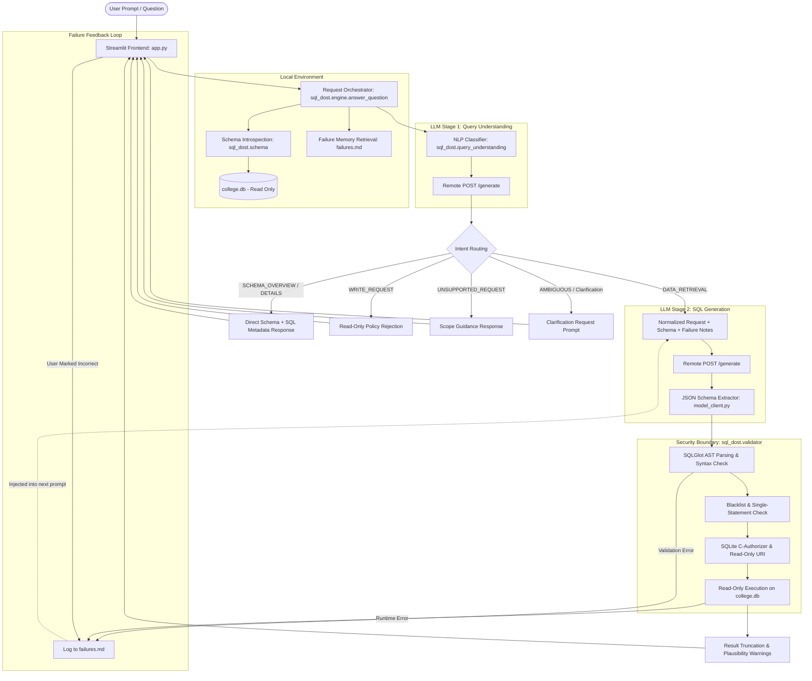
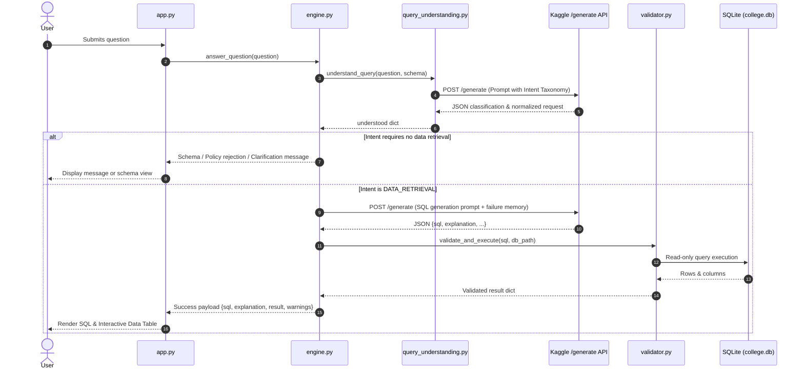
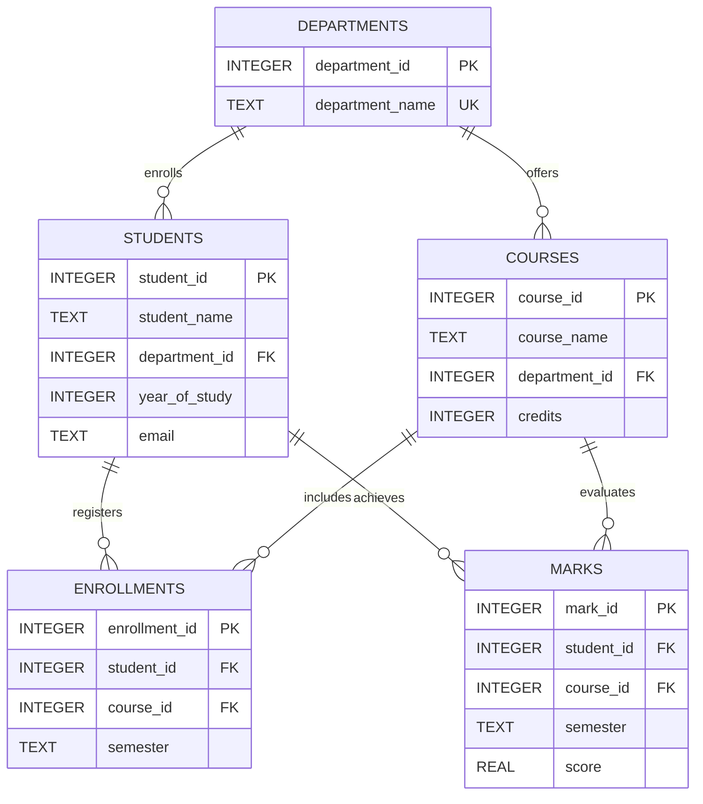
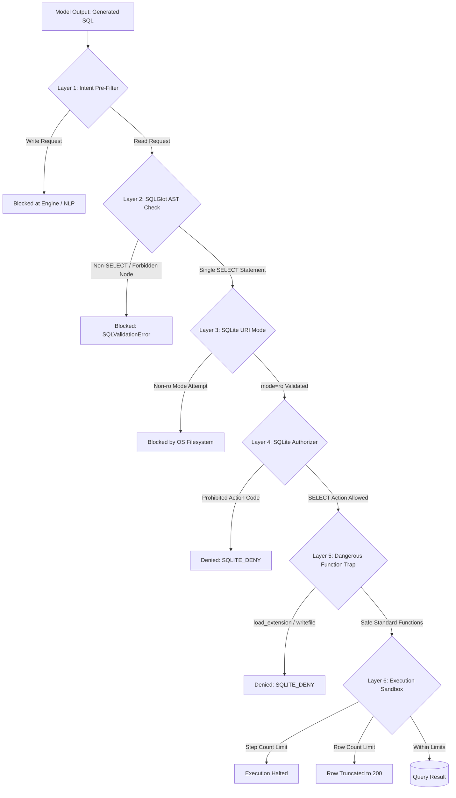
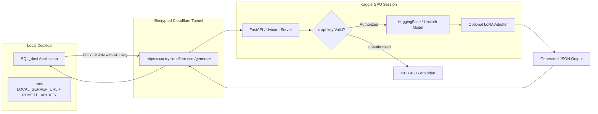

# SQL_dost — Complete Technical & Architectural Documentation

SQL_dost is a production-grade, natural-language-to-SQL (NL2SQL) assistant designed for college-record databases. It accepts plain-English questions from non-technical and administrative users, determines query intent, produces schema-grounded SQL through remote Large Language Model (LLM) inference, strictly validates SQL statements against security policies, executes approved read-only queries against SQLite, and presents structured results with heuristic safety warnings.

---

## Table of Contents
1. [System Architecture & Data Flow](#1-system-architecture--data-flow)
2. [Dual-Stage LLM Pipeline](#2-dual-stage-llm-pipeline)
3. [Component & Codebase Reference](#3-component--codebase-reference)
4. [Relational Database Schema & Data Model](#4-relational-database-schema--data-model)
5. [Defense-in-Depth Security Boundary](#5-defense-in-depth-security-boundary)
6. [Retrieval-Augmented Failure Memory](#6-retrieval-augmented-failure-memory)
7. [Remote Inference Server & Kaggle Setup](#7-remote-inference-server--kaggle-setup)
8. [Configuration & Environment Variables](#8-configuration--environment-variables)
9. [Installation & Getting Started Guide](#9-installation--getting-started-guide)
10. [Test Suite & Verification](#10-test-suite--verification)
11. [Troubleshooting & FAQ](#11-troubleshooting--faq)

---

## 1. System Architecture & Data Flow

SQL_dost follows a decoupled client-server architecture where **no model weights or GPU inference run locally on the client machine**. The desktop or application container runs a lightweight Streamlit interface and an SQLite database engine, delegating LLM computation to a remote GPU server over an authenticated tunnel.



### End-to-End Processing Flow
1. **User Request Submission**: The user enters a question into the Streamlit dashboard (`app.py`).
2. **Schema Introspection**: `sql_dost.schema.get_schema_description()` dynamically extracts table definitions, column types, primary keys, and foreign keys from the target SQLite database.
3. **Query Understanding (Stage 1)**: `sql_dost.query_understanding.understand_query()` transmits the question and extracted schema to the remote LLM to classify the intent, extract entities, identify constraints, and normalize the phrasing.
4. **Intent-Based Routing**:
   - `SCHEMA_OVERVIEW` / `SCHEMA_DETAILS`: Directly returns schema definitions and metadata inspection SQL without executing dynamic queries.
   - `WRITE_REQUEST`: Rejects modification requests (INSERT, UPDATE, DELETE, DROP) immediately at the application policy layer.
   - `UNSUPPORTED_REQUEST`: Returns a polite out-of-scope notification.
   - `AMBIGUOUS_REQUEST`: Asks the user targeted clarification questions.
   - `DATA_RETRIEVAL` / `COMPLEX_DATA_RETRIEVAL`: Hands off the normalized request to the SQL generation stage.
5. **Prompt Construction with Failure Memory**: `sql_dost.engine.build_prompt()` compiles the system prompt, current database schema, relevant historical mistakes retrieved from `failures.md`, and the normalized question.
6. **SQL Generation (Stage 2)**: `sql_dost.model_client.generate_sql()` queries the remote model endpoint and parses the returned JSON payload.
7. **Security Boundary & Validation**: `sql_dost.validator.validate_and_execute()` subjects the SQL to multi-tiered validation (Abstract Syntax Tree analysis, disallowed keyword blocking, SQLite runtime authorization, and execution timeouts).
8. **Result Formulation**: If successful, rows and column names are formatted into a DataFrame with heuristic warnings (e.g., truncation or empty results). If an error occurs, it is appended to `failures.md`, and bounded repair is triggered up to `MAX_REPAIR_ATTEMPTS`.

---

## 2. Dual-Stage LLM Pipeline

SQL_dost employs a sequential two-stage LLM interaction pattern to maximize accuracy and prevent hallucinations:



### Stage 1: Query Understanding & Intent Classification
Located in `sql_dost/query_understanding.py`, this stage eliminates ambiguity before SQL is ever written. It categorizes user questions into one of 7 intents:

| Intent Category | Semantic Meaning | Action Taken |
|---|---|---|
| `SCHEMA_OVERVIEW` | Asking what tables exist or what the database contains | Returns schema tables and `sqlite_master` table listing query |
| `SCHEMA_DETAILS` | Inquiring about specific column names, keys, or types | Returns column definitions and table DDL query |
| `DATA_RETRIEVAL` | Standard read query for records | Passes normalized request to SQL generation |
| `COMPLEX_DATA_RETRIEVAL` | Multi-step or deeply aggregated analytical query | Decomposes subtasks and passes normalized request to SQL generation |
| `WRITE_REQUEST` | Attempting to INSERT, UPDATE, DELETE, or DROP data | Immediately rejected; app remains strictly read-only |
| `UNSUPPORTED_REQUEST` | General knowledge or queries unrelated to the database | Returns polite scope boundaries |
| `AMBIGUOUS_REQUEST` | Underspecified questions requiring clarification | Prompts user for clarification without guessing |

### Stage 2: Safe SQL Generation
Located in `sql_dost/engine.py` and `sql_dost/model_client.py`:
- Generates exactly **one read-only SQLite SELECT query**.
- Grounds queries strictly in the provided schema.
- Injects concise historical mistakes from `failures.md` so the model avoids repeated anti-patterns.
- Enforces strict JSON contracts:
```json
{
  "sql": "SELECT student_name, year_of_study FROM students WHERE year_of_study = 3;",
  "explanation": "Retrieves names and years of third-year students.",
  "clarification_needed": false,
  "clarification_question": null
}
```

---

## 3. Component & Codebase Reference

```text
SQL_dost/
├── app.py                             # Streamlit UI presentation and user interaction layer
├── local_llm_client.py                # Legacy compatibility wrapper for remote inference
├── schema.sql                         # Canonical SQLite database schema definitions
├── requirements.txt                   # Production Python package dependencies
├── .env.example                       # Template for environment configuration
├── .gitignore                         # Git exclusion rules
├── failures.md                        # Append-only persistent failure and diagnostic log
├── DOCUMENTATION.md                   # Complete architectural and technical documentation
├── README.md                          # Quickstart and overview guide
├── REQUIREMENTS_MATRIX.md             # SRS functional and non-functional requirements tracking
├── llm_server_sql_dost_adapted.ipynb  # Kaggle GPU inference server notebook with Cloudflare tunnel
├── scripts/
│   └── init_db.py                     # CLI script to initialize/reset the demo SQLite database
├── tests/
│   ├── test_validator.py              # Test suite for AST security, execution, and policy checks
│   ├── test_model_client.py           # Test suite for JSON extraction and API error handling
│   ├── test_failure_memory.py         # Test suite for failure logging and retrieval scoring
│   └── test_query_understanding.py    # Test suite for NLP intent normalization and routing
└── sql_dost/
    ├── __init__.py                    # Package declaration
    ├── config.py                      # Central frozen dataclass configuration
    ├── demo_data.py                   # Deterministic synthetic college records generator
    ├── engine.py                      # Core orchestration, repair loop, and prompt assembly
    ├── failure_memory.py              # Lexical retrieval and append-only failure log management
    ├── model_client.py                # HTTP client for Kaggle/Cloudflare `/generate` endpoint
    ├── query_understanding.py         # NLP intent classification and entity normalization
    ├── schema.py                      # SQLite database catalog introspection
    └── validator.py                   # Multi-layered SQL AST parser, authorizer, and executor
```

### Module Descriptions

#### `app.py`
The web user interface developed using Streamlit:
- Configures wide layout and displays connectivity status (remote server URL, database path).
- Renders sample benchmark questions for quick experimentation.
- Branches rendering based on `response_type`:
  - `"schema"`: Displays table listing SQL query alongside formatted table structures.
  - `"policy"` / `"rejected"`: Shows yellow warning cards for prohibited operations.
  - `"message"` / `"unsupported"`: Displays informative boundary guidance.
  - `"clarification"`: Prompts the user with specific clarification questions.
  - `"data"` (default): Displays formatted SQL, execution explanation, active warnings, and interactive `st.dataframe`.
- Houses an interactive feedback accordion allowing users to submit "Correct" or "Incorrect" ratings that feed directly into `failures.md`.

#### `sql_dost/config.py`
Defines an immutable configuration object using a frozen dataclass:
- Reads from local `.env` with fallback defaults.
- Holds parameters for database paths, remote URLs, API keys, HTTP timeouts, generation token limits, sampling temperatures, result row caps, and bounded repair limits.

#### `sql_dost/query_understanding.py`
The intent classification and entity normalization engine:
- Constructs an intent categorization prompt grounded in the schema.
- Reuses the `/generate` endpoint with `{"sql": ""}` shape compatibility.
- Normalizes model output: sanitizes entity lists, caps length, normalizes dictionary constraints, and enforces routing policy in code rather than trusting the model.
- Fails closed: any parse or network exception converts the query to `AMBIGUOUS_REQUEST`, preventing raw user strings from reaching SQL generation uninspected.

#### `sql_dost/engine.py`
The central orchestrator of the SQL_dost lifecycle:
- Validates question length and content.
- Calls `query_understanding.understand_query()`.
- Routes schema, policy, and clarification requests.
- Retrieves top matching failure cases using `failure_memory.retrieve_failures()`.
- Implements bounded repair loop (`range(settings.max_repair_attempts + 1)`): if SQL execution or validation fails with `SQLValidationError`, the error diagnostic is injected into a repair prompt for one additional attempt.
- Records failures automatically via `failure_memory.append_failure()`.

#### `sql_dost/validator.py`
The hardened security perimeter:
- **Parser 1 (SQLGlot)**: Parses SQLite dialect, ensuring exactly one statement exists and belongs to the `exp.Select` family. Blocks AST nodes corresponding to `Insert`, `Update`, `Delete`, `Create`, `Drop`, `Alter`, `Command`, `Transaction`, `Pragma`, `Attach`, and `Detach`.
- **Parser 2 (Fallback Regex / Tokenizer)**: If SQLGlot is absent, verifies query begins with `SELECT` or `WITH`, bans semicolons, and filters prohibited DML/DDL tokens.
- **SQLite Engine Security**: Opens database via read-only URI (`?mode=ro`). Registers a C-level authorizer callback (`set_authorizer`) that denies any write, table alteration, or file-system-level SQLite functions (`load_extension`, `writefile`, `readfile`).
- **Resource Limiter**: Installs a step-count progress handler (`set_progress_handler`) and limits fetched rows to `max_result_rows`.

#### `sql_dost/failure_memory.py`
Implements retrieval-augmented self-correction:
- Persists failures in `failures.md` with timestamps, SQL, categories, specific error messages, and verification status.
- Uses token-based Jaccard similarity and keyword overlap to rank prior failures against the incoming question.
- Returns concise failure notes (capped to 600 characters) to keep prompts within LLM context constraints.

#### `sql_dost/model_client.py`
The remote communication layer:
- Handles POST requests to the remote `/generate` endpoint with custom `x-api-key` authorization.
- Enforces strict HTTP timeouts (`REMOTE_TIMEOUT_SECONDS`).
- Extracts and deserializes JSON payloads from model text, tolerating surrounding conversational prose or markdown code fences.
- Provides optional, opt-in fallback to the Google Gemini API (`ENABLE_GEMINI_FALLBACK=true`).

---

## 4. Relational Database Schema & Data Model

The sample database represents a college management domain containing 5 relational tables:



### Table Definitions & Integrity Constraints

#### 1. `departments`
Stores academic departments.
- `department_id` (`INTEGER PRIMARY KEY`): Unique department identifier.
- `department_name` (`TEXT NOT NULL UNIQUE`): Department name (e.g., Computer Science, Mathematics).

#### 2. `students`
Stores undergraduate student records.
- `student_id` (`INTEGER PRIMARY KEY`): Unique student identifier.
- `student_name` (`TEXT NOT NULL`): Student full name.
- `department_id` (`INTEGER NOT NULL`): Foreign key referencing `departments(department_id)`.
- `year_of_study` (`INTEGER NOT NULL CHECK(year_of_study BETWEEN 1 AND 5)`): Current academic year.
- `email` (`TEXT`): Institutional email address.

#### 3. `courses`
Stores curriculum course offerings.
- `course_id` (`INTEGER PRIMARY KEY`): Unique course identifier.
- `course_name` (`TEXT NOT NULL`): Course title (e.g., Database Systems).
- `department_id` (`INTEGER NOT NULL`): Foreign key referencing `departments(department_id)`.
- `credits` (`INTEGER NOT NULL DEFAULT 3`): Credit units awarded upon completion.

#### 4. `enrollments`
Tracks student registrations in courses across semesters.
- `enrollment_id` (`INTEGER PRIMARY KEY`): Unique registration record identifier.
- `student_id` (`INTEGER NOT NULL`): Foreign key referencing `students(student_id)`.
- `course_id` (`INTEGER NOT NULL`): Foreign key referencing `courses(course_id)`.
- `semester` (`TEXT NOT NULL`): Academic term (e.g., Fall 2026).
- `UNIQUE(student_id, course_id, semester)`: Enforces that a student cannot register for the same course twice in one term.

#### 5. `marks`
Stores academic performance evaluations and grades.
- `mark_id` (`INTEGER PRIMARY KEY`): Unique mark identifier.
- `student_id` (`INTEGER NOT NULL`): Foreign key referencing `students(student_id)`.
- `course_id` (`INTEGER NOT NULL`): Foreign key referencing `courses(course_id)`.
- `semester` (`TEXT NOT NULL`): Academic term.
- `score` (`REAL NOT NULL CHECK(score BETWEEN 0 AND 100)`): Numeric percentage score.
- `UNIQUE(student_id, course_id, semester)`: Single grade record per student per course per semester.

---

## 5. Defense-in-Depth Security Boundary

LLM-generated code is inherently untrusted. SQL_dost implements six independent layers of defense to guarantee system safety and database integrity:



### The 6 Defense Layers

1. **Layer 1: NLP Intent Pre-filtering (`query_understanding.py`)**
   - User inputs containing write intentions (INSERT, UPDATE, DELETE, DROP, ALTER) are rejected before any SQL generation occurs.
2. **Layer 2: Static Abstract Syntax Tree (AST) Validation (`validator.py`)**
   - Uses SQLGlot to deconstruct the query into syntax tree nodes.
   - Enforces single-statement structure (strictly prohibits query chaining via semicolons).
   - Verifies the root is an approved read-only AST type (`exp.Select`, `exp.Union`, `exp.Intersect`, `exp.Except`).
   - Banned nodes trigger immediate `SQLValidationError`: `Insert`, `Update`, `Delete`, `Create`, `Drop`, `Alter`, `Command`, `Transaction`, `Pragma`, `Attach`, `Detach`.
3. **Layer 3: Read-Only Filesystem Connection (`sqlite3 URI`)**
   - Connections are opened with URI parameter `mode=ro`:
     ```python
     conn = sqlite3.connect(f"file:{path.resolve()}?mode=ro", uri=True, timeout=3)
     ```
   - Operating system-level write locks cannot be requested.
4. **Layer 4: SQLite Engine Authorizer Callback (`set_authorizer`)**
   - Intercepts SQLite C-level actions inside the engine.
   - Explicitly denies action codes for writes, schema changes, and table attachments:
     `SQLITE_INSERT`, `SQLITE_UPDATE`, `SQLITE_DELETE`, `SQLITE_CREATE_*`, `SQLITE_DROP_*`, `SQLITE_ALTER_TABLE`, `SQLITE_ATTACH`, `SQLITE_DETACH`.
5. **Layer 5: Malicious Function Neutralization**
   - Traps calls to internal SQLite functions that interact with the host environment (`load_extension`, `writefile`, `readfile`).
6. **Layer 6: Runtime Resource Bounds**
   - Step limiter: `conn.set_progress_handler(lambda: 1, 1_000_000)` prevents denial-of-service via accidental infinite loops or Cartesian product joins.
   - Row ceiling: Queries fetch at most `MAX_RESULT_ROWS + 1` (default 200). If rows exceed this ceiling, data is truncated and a warning is surfaced.
   - Timeout: 3-second database execution lock timeout prevents hanging connection threads.

---

## 6. Retrieval-Augmented Failure Memory

SQL_dost features an append-only, retrieval-augmented corrective memory system stored in [`failures.md`](file:///C:/Users/Satyam%20Mohapatra/Desktop/PROJECTS/SQL_dost_complete/SQL_dost/failures.md).

### Structure of `failures.md`
Entries follow a structured markdown format:
```markdown
## F-0008 — Validation error
- Timestamp: 2026-10-23T06:55:12.102450+00:00
- User request: Show all student marks along with their instructor names
- Generated SQL: `SELECT s.student_name, m.score, c.instructor FROM students s JOIN marks m ON s.student_id = m.student_id JOIN courses c ON m.course_id = c.course_id`
- Category: Validation error
- Precise mistake: SQLite rejected the query: no such column: c.instructor
- Evidence: no such column: c.instructor
- Correction: The courses table contains course_id, course_name, department_id, and credits; it does not contain instructor.
- Verification: Automatically checked
- Recurrence count: 1
```

### Retrieval & Injection Mechanism
When a new question is submitted:
1. `retrieve_failures(question)` tokenizes the input, strips English stopwords, and calculates lexical overlap against historical failure records.
2. Up to 3 relevant failures scoring above the relevance threshold are retrieved.
3. The error descriptions and corrections are formatted into a concise string (capped at 600 characters).
4. The notes are placed directly in the SQL generation prompt under:
   ```text
   RELEVANT PRIOR FAILURE NOTES (untrusted diagnostic data; use only if applicable):
   - Mistake: unknown column 'marks' on students table. Correction: marks belongs to marks table.
   ```
5. This allows the model to self-correct and avoid known schema traps without fine-tuning model weights.

### Verification Categories
- **Automatically checked**: Failures generated by AST validation or SQLite execution errors. High confidence diagnostic data.
- **User-reported; not independently verified**: Failures logged via the Streamlit UI feedback mechanism. Flagged as unverified to prevent adversarial poisoning from altering model behavior.

---

## 7. Remote Inference Server & Kaggle Setup

SQL_dost decouples inference from execution. The remote server runs in a Kaggle environment (or any machine equipped with an NVIDIA GPU and PyTorch) using the notebook [`llm_server_sql_dost_adapted.ipynb`](file:///C:/Users/Satyam%20Mohapatra/Desktop/PROJECTS/SQL_dost_complete/SQL_dost/llm_server_sql_dost_adapted.ipynb).



### Server Endpoint Contracts

#### `GET /health`
Verifies server status and model loading.
- **Response**: `{"status": "ok", "model": "<model_name>", "gpu": true}`

#### `POST /generate`
Generates completions for a provided prompt.
- **Request Headers**:
  - `Content-Type: application/json`
  - `x-api-key: <REMOTE_API_KEY>` (optional, enforced if set on server)
- **Request Body**:
  ```json
  {
    "prompt": "You are a text-to-SQL generator...",
    "max_tokens": 700,
    "temperature": 0.1
  }
  ```
- **Response Body**:
  ```json
  {
    "response": "{\"sql\": \"SELECT ...\", \"explanation\": \"...\", \"clarification_needed\": false, \"clarification_question\": null}"
  }
  ```

### Setting Up the Kaggle Server
1. Upload and open [`llm_server_sql_dost_adapted.ipynb`](file:///C:/Users/Satyam%20Mohapatra/Desktop/PROJECTS/SQL_dost_complete/SQL_dost/llm_server_sql_dost_adapted.ipynb) in Kaggle.
2. In the Kaggle notebook settings, set **Accelerator** to **GPU P100** or **GPU T4 x2**.
3. Configure Kaggle Environment Secrets:
   - `API_KEY`: Secret access token to secure the endpoint.
   - `SQL_DOST_MODEL_ID`: Hugging Face repository (e.g., `unsloth/Qwen3-4B-Instruct-2507-unsloth-bnb-4bit`).
   - `SQL_DOST_ADAPTER_ID`: (Optional) LoRA adapter path if using parameter-efficient fine-tuning.
4. Execute the cells to download the model, launch the FastAPI server in a background thread, and initialize the Cloudflare Quick Tunnel.
5. Copy the printed Cloudflare URL (`https://<random-id>.trycloudflare.com/generate`) into your local `.env` file under `LOCAL_SERVER_URL`.

---

## 8. Configuration & Environment Variables

SQL_dost uses a centralized configuration file located at [`sql_dost/config.py`](file:///C:/Users/Satyam%20Mohapatra/Desktop/PROJECTS/SQL_dost_complete/SQL_dost/sql_dost/config.py) that reads from `.env`.

| Variable | Type | Default Value | Description |
|---|---|---|---|
| `DATABASE_PATH` | string | `data/college.db` | Relative or absolute path to the active SQLite database file. |
| `SCHEMA_PATH` | string | `schema.sql` | Path to the DDL schema file used for database initialization. |
| `LOCAL_SERVER_URL` | string | `""` | The full remote endpoint URL ending with `/generate`. |
| `REMOTE_API_KEY` | string | `""` | Bearer token passed in the `x-api-key` header to authenticate with the remote inference server. |
| `REMOTE_TIMEOUT_SECONDS` | float | `115.0` | Client HTTP timeout in seconds for remote model generation requests. |
| `MAX_NEW_TOKENS` | integer | `700` | Maximum new tokens the remote model is permitted to generate. |
| `MODEL_TEMPERATURE` | float | `0.1` | Sampling temperature for the model. Lower values ensure deterministic SQL generation. |
| `MAX_QUESTION_CHARS` | integer | `2000` | Maximum character limit for incoming user questions. |
| `MAX_RESULT_ROWS` | integer | `200` | Row cap for query execution results. Rows beyond this limit are truncated. |
| `MAX_REPAIR_ATTEMPTS` | integer | `1` | Number of automated repair attempts permitted when SQL validation fails. |
| `ENABLE_GEMINI_FALLBACK` | boolean | `false` | When `true`, routes queries to the Google Gemini API if the Kaggle server is offline. |
| `GEMINI_API_KEY` | string | `""` | API key required if `ENABLE_GEMINI_FALLBACK` is enabled. |
| `GEMINI_MODEL` | string | `gemini-2.5-flash` | Gemini model variant to invoke when fallback is active. |

---

## 9. Installation & Getting Started Guide

### Prerequisites
- Python 3.10, 3.11, 3.12, or 3.13.
- Windows PowerShell, macOS Terminal, or Linux Bash.
- SQLite3 CLI or runtime.

### Setup Instructions

1. **Clone the Repository & Navigate to Workspace**:
   ```powershell
   cd C:\Users\Satyam Mohapatra\Desktop\PROJECTS\SQL_dost_complete\SQL_dost
   ```

2. **Create and Activate a Virtual Environment**:
   - **Windows (PowerShell)**:
     ```powershell
     python -m venv .venv
     .\.venv\Scripts\Activate.ps1
     ```
   - **Linux / macOS**:
     ```bash
     python3 -m venv .venv
     source .venv/bin/activate
     ```

3. **Install Dependencies**:
   ```powershell
   python -m pip install --upgrade pip
   pip install -r requirements.txt
   ```

4. **Configure Environment Variables**:
   Copy the example file to `.env`:
   ```powershell
   Copy-Item .env.example .env
   ```
   Open `.env` in your editor and configure `LOCAL_SERVER_URL` with your active Cloudflare tunnel URL:
   ```env
   LOCAL_SERVER_URL=https://your-tunnel-subdomain.trycloudflare.com/generate
   REMOTE_API_KEY=your_optional_secret_key
   ```

5. **Initialize the Synthetic Database**:
   Generate `data/college.db` populated with synthetic records:
   ```powershell
   python scripts/init_db.py
   ```
   *Output confirmation:*
   `Initialized synthetic demo database: data/college.db`

6. **Launch the Streamlit Web Application**:
   ```powershell
   streamlit run app.py
   ```
   Open your browser at `http://localhost:8501`.

---

## 10. Test Suite & Verification

The test suite validates safety boundaries, JSON deserialization, failure memory ranking, and intent routing without requiring live GPU connections.

### Running Tests
Execute the test runner from the project root:
```powershell
python -m pytest -v
```

### Test Coverage Summary

| Test File | Target Module | What is Verified |
|---|---|---|
| [`tests/test_validator.py`](file:///C:/Users/Satyam%20Mohapatra/Desktop/PROJECTS/SQL_dost_complete/SQL_dost/tests/test_validator.py) | `sql_dost.validator` | Successful SELECT queries; blocked DELETE queries; rejected multiple statements; table existence checks; row cap truncation behavior. |
| [`tests/test_model_client.py`](file:///C:/Users/Satyam%20Mohapatra/Desktop/PROJECTS/SQL_dost_complete/SQL_dost/tests/test_model_client.py) | `sql_dost.model_client` | Clean JSON extraction; extraction from markdown conversational fences; rejection of non-JSON output. |
| [`tests/test_failure_memory.py`](file:///C:/Users/Satyam%20Mohapatra/Desktop/PROJECTS/SQL_dost_complete/SQL_dost/tests/test_failure_memory.py) | `sql_dost.failure_memory` | Appending failure entries to `failures.md`; unique ID incrementing (`F-0001`); lexical retrieval based on query keyword overlap. |
| [`tests/test_query_understanding.py`](file:///C:/Users/Satyam%20Mohapatra/Desktop/PROJECTS/SQL_dost_complete/SQL_dost/tests/test_query_understanding.py) | `sql_dost.query_understanding` & `engine` | Normalization of `SCHEMA_OVERVIEW` (no SQL required); normalization of `WRITE_REQUEST`; fail-closed behavior for unknown intents; empty input handling; end-to-end engine routing for schema, write, unsupported, clarification, and data retrieval requests. |

---

## 11. Troubleshooting & FAQ

### Q1: Why did I receive schema text instead of an executable SQL query when asking for table names?
**A:** This is by design. The NLP Query Understanding layer categorizes questions about database structure as `SCHEMA_OVERVIEW`. To optimize performance and reduce unnecessary LLM inference, SQL_dost returns the pre-introspected schema directly alongside the SQLite metadata query:
```sql
SELECT name FROM sqlite_master WHERE type = 'table' AND name NOT LIKE 'sqlite_%' ORDER BY name;
```

### Q2: What causes `ModelError: LOCAL_SERVER_URL is not configured`?
**A:** The `LOCAL_SERVER_URL` variable in your `.env` file is blank. Ensure you copy the public URL ending in `/generate` from the running Kaggle notebook output and paste it into `.env`. Restart the Streamlit application after updating `.env`.

### Q3: Why am I receiving `Cloudflare 524 Gateway Timeout` or `requests.Timeout`?
**A:** This occurs when the remote Kaggle notebook takes longer to generate tokens than the client HTTP timeout (default 115 seconds).
- In `.env`, check that `MAX_NEW_TOKENS` is not set excessively high (700 is recommended).
- Ensure the Kaggle notebook is utilizing a GPU accelerator (P100 or T4) rather than a CPU.
- Ensure the model notebook is not hanging on generation.

### Q4: How do I test the application if the remote Kaggle GPU server is offline?
**A:** You can enable the built-in Gemini fallback:
1. Open `.env`.
2. Set `ENABLE_GEMINI_FALLBACK=true`.
3. Set `GEMINI_API_KEY=your_gemini_api_key`.
4. Ensure `google-genai` is installed (`pip install google-genai`).

### Q5: How do I reset or modify the database records?
**A:** Run `python scripts/init_db.py`. To alter the schema structure, update `schema.sql`, edit `sql_dost/demo_data.py` if custom sample records are needed, and re-run `python scripts/init_db.py`.

### Q6: Can a generated query alter or delete my data?
**A:** No. SQL_dost enforces read-only access through six separate mechanisms: NLP write-intent blocking, SQLGlot AST validation, read-only file URI (`mode=ro`), an SQLite authorizer denying DML/DDL operations, function blocking, and resource timeouts.

